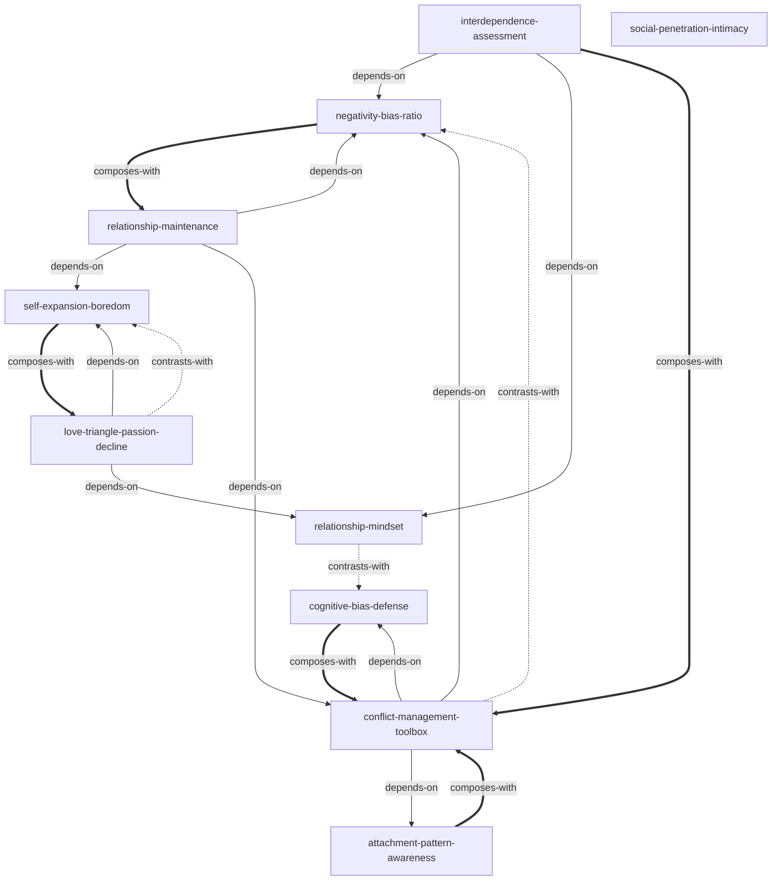

# 亲密关系（Intimate Relationships）· 技能集

由罗兰·米勒（Rowland S. Miller）《亲密关系（第6版）》蒸馏出的一组**可被 AI Agent 调用的技能**（Skills）。

> 亲密关系是人类经验的核心。吸引力、认知、沟通、相互依赖——多重因素的动态交互决定了关系的质量与走向。
> 本书用社会心理学的实证研究，系统揭示了亲密关系从建立、维持到解体的全过程规律。
> 本项目把这套科学认知提炼成 10 个原子化技能，覆盖关系评估、认知信念、爱情激情、亲密建立、冲突管理与长期维持六大主题。

---

## 来源

| | |
|---|---|
| **书名** | 亲密关系（第6版）（*Intimate Relationships*） |
| **作者** | 罗兰·米勒（Rowland S. Miller） |
| **出版** | 第6版 |
| **蒸馏工具** | cangjie-skill（仓颉：把长内容蒸馏成可调用技能的流水线） |
| **蒸馏方法** | RIA-TV++（整书理解 → 并行提取 → 三重验证 → RIA++ 构造 → 链接 → 压力测试 → 交付） |

---

## 10 个技能

### 关系评估框架

- [`interdependence-assessment`](skills/interdependence-assessment/SKILL.md) — **相互依赖关系评估**：用奖赏-代价-CL-CLalt 模型判断关系满意度与稳定性
- [`negativity-bias-ratio`](skills/negativity-bias-ratio/SKILL.md) — **坏比好更有力量与 5:1 黄金比例**：正负互动比率预测关系存续

### 关系认知与信念

- [`relationship-mindset`](skills/relationship-mindset/SKILL.md) — **关系信念**：宿命型 vs 成长型思维对关系的深远影响
- [`cognitive-bias-defense`](skills/cognitive-bias-defense/SKILL.md) — **关系认知偏差防御**：首因效应、证实偏差、归因偏差、自我实现预言

### 爱情与激情

- [`love-triangle-passion-decline`](skills/love-triangle-passion-decline/SKILL.md) — **爱情三角理论与激情消退规律**：区分激情消退与爱情消亡
- [`self-expansion-boredom`](skills/self-expansion-boredom/SKILL.md) — **自我延伸模型与关系厌倦**：通过共同成长重燃关系活力

### 关系建立与亲密

- [`social-penetration-intimacy`](skills/social-penetration-intimacy/SKILL.md) — **社会渗透与亲密建立**：自我表露的深度与广度如何推进关系
- [`attachment-pattern-awareness`](skills/attachment-pattern-awareness/SKILL.md) — **依恋类型自我觉察**：焦虑型、回避型与安全型的行为模式

### 冲突与维持

- [`conflict-management-toolbox`](skills/conflict-management-toolbox/SKILL.md) — **冲突管理工具箱**：从"害怕冲突"转向"有效管理冲突"
- [`relationship-maintenance`](skills/relationship-maintenance/SKILL.md) — **关系维持策略库**：长期亲密关系的经营之道

---

## 技能之间的引用关系



图例：`-->` 依赖 · `-.->` 二选一 · `===>` 常配合使用

**推荐学习顺序**（从依赖图叶子节点向上）：

1. `negativity-bias-ratio` — 最基础，理解正负不对称原理
2. `relationship-mindset` — 理解关系信念如何影响行为和结果
3. `attachment-pattern-awareness` — 理解依恋模式的个体差异
4. `cognitive-bias-defense` — 理解关系中的认知偏差机制
5. `social-penetration-intimacy` — 理解亲密感如何建立
6. `interdependence-assessment` — 关系评估框架（依赖 1+2）
7. `self-expansion-boredom` — 理解关系厌倦的本质（依赖 1+2+3）
8. `love-triangle-passion-decline` — 爱情分类与激情消退（依赖 7+2）
9. `conflict-management-toolbox` — 冲突管理工具（依赖 1+3+4）
10. `relationship-maintenance` — 关系维持策略库（依赖 1+7+9，最后学）

---

## 快速开始

每个技能目录都包含 `SKILL.md`（+ `test-prompts.json` / `test-results.md` 测试产物），可直接复制到宿主环境：

```bash
# Claude Code（用户级，所有项目可用）
cp -r skills/* ~/.claude/skills/

# 或 Claude Code（项目级）
cp -r skills/* <project>/.claude/skills/

# Trae（项目级）
cp -r skills/* <project>/.trae/skills/

# Cursor（项目级）
cp -r skills/* <project>/.cursor/skills/
```

---

## 完整文档

`docs/` 目录保留了完整的蒸馏产物与审计轨迹：

| 文件 | 说明 |
|---|---|
| [`DIGEST.md`](docs/DIGEST.md) | 面向读者的精华长文（不读全书看这篇） |
| [`GLOSSARY.md`](docs/GLOSSARY.md) | 共享术语词典 |
| [`INDEX.md`](docs/INDEX.md) | 技能总览 + 引用图 + 学习顺序 |
| [`BOOK_OVERVIEW.md`](docs/BOOK_OVERVIEW.md) | 整书理解（结构/解释/批判/应用潜力） |
| [`verified.md`](docs/verified.md) | 三重验证结果（候选池 → 10 通过） |
| [`PIPELINE_STATE.md`](docs/PIPELINE_STATE.md) | 流水线各阶段状态 |
| [`candidates/`](docs/candidates/) | 5 个提取器的原始候选池（框架/原则/案例/反例/术语） |

---

## 目录结构

```text
intimate-relationships/
├── README.md
├── skills/                      # 10 个可安装技能（核心交付物）
│   └── <skill-slug>/
│       ├── SKILL.md             # 技能定义（R/I/A1/A2/E/B 六段）
│       ├── test-prompts.json    # 触发/诱饵测试集
│       └── test-results.md      # 压力测试结果
└── docs/                        # 蒸馏文档与审计轨迹
    ├── DIGEST.md / GLOSSARY.md / INDEX.md
    ├── BOOK_OVERVIEW.md / verified.md / PIPELINE_STATE.md
    └── candidates/              # 框架/原则/案例/反例/术语 候选池
```

---

## 关于内容与版权

本项目是**方法论蒸馏产物**，不含原书全文：

- 每个技能对原书的引用严格控制在合理引用范畴；
- 原文的版权归原作者罗兰·米勒（Rowland S. Miller）及出版社所有；
- 建议购买正版书籍配合使用。
