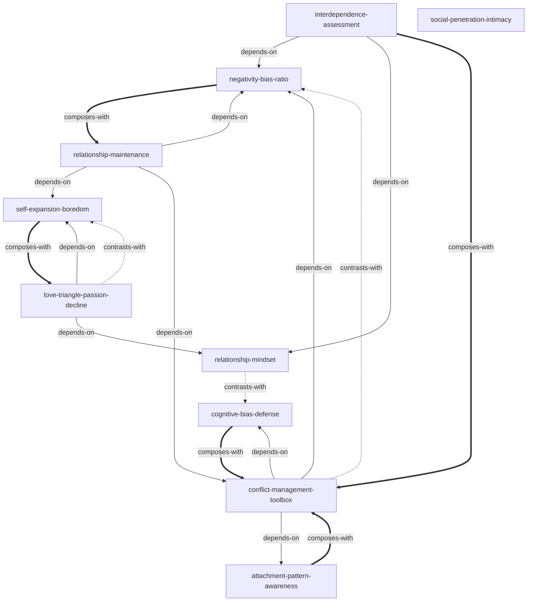

# INDEX — 亲密关系 Skill Index

> 本书由 cangjie-skill 蒸馏，共产出 **10** 个 skills
> 作者: Rowland S. Miller | 第6版 | 处理时间: 2026-10-12

## 关于这本书

- **书名**: 亲密关系（第6版）
- **作者**: Rowland S. Miller
- **一句话主旨**: 亲密关系是人类经验的核心，其质量取决于吸引力、认知、沟通、相互依赖等多重因素的动态交互；科学认识这些因素能帮助我们经营关系、应对冲突、修复损伤
- **整书理解**: [BOOK_OVERVIEW.md](./BOOK_OVERVIEW.md)
- **术语词典**: [GLOSSARY.md](./GLOSSARY.md)

---

## Skill 列表 (按主题分组)

### 关系评估框架

- [`interdependence-assessment`](./interdependence-assessment/SKILL.md) — 相互依赖关系评估：用奖赏-代价-CL-CLalt 模型判断关系满意度与稳定性
- [`negativity-bias-ratio`](./negativity-bias-ratio/SKILL.md) — 坏比好更有力量与 5:1 黄金比例：正负互动比率预测关系存续

### 关系认知与信念

- [`relationship-mindset`](./relationship-mindset/SKILL.md) — 关系信念：宿命型 vs 成长型
- [`cognitive-bias-defense`](./cognitive-bias-defense/SKILL.md) — 关系认知偏差防御：首因效应、证实偏差、归因偏差、自我实现预言

### 爱情与激情

- [`love-triangle-passion-decline`](./love-triangle-passion-decline/SKILL.md) — 爱情三角理论与激情消退规律
- [`self-expansion-boredom`](./self-expansion-boredom/SKILL.md) — 自我延伸模型与关系厌倦

### 关系建立与亲密

- [`social-penetration-intimacy`](./social-penetration-intimacy/SKILL.md) — 社会渗透与亲密建立
- [`attachment-pattern-awareness`](./attachment-pattern-awareness/SKILL.md) — 依恋类型自我觉察

### 冲突与维持

- [`conflict-management-toolbox`](./conflict-management-toolbox/SKILL.md) — 冲突管理工具箱
- [`relationship-maintenance`](./relationship-maintenance/SKILL.md) — 关系维持策略库

---

## 引用图

图例:
- `-->`  depends-on (A 的使用前提是先理解 B)
- `-.->` contrasts-with (A 和 B 是两种可选方案)
- `===>` composes-with (A 和 B 经常配合使用)

---

## 推荐学习顺序

(从依赖图的叶子节点开始，向上)

1. **negativity-bias-ratio** — 最基础，理解正负不对称原理
2. **relationship-mindset** — 理解关系信念如何影响行为和结果
3. **attachment-pattern-awareness** — 理解依恋模式的个体差异
4. **cognitive-bias-defense** — 理解关系中的认知偏差机制
5. **social-penetration-intimacy** — 理解亲密感如何建立
6. **interdependence-assessment** — 关系评估框架（依赖 1+2）
7. **self-expansion-boredom** — 理解关系厌倦的本质（依赖 1+2+3）
8. **love-triangle-passion-decline** — 爱情分类与激情消退（依赖 7+2）
9. **conflict-management-toolbox** — 冲突管理工具（依赖 1+3+4）
10. **relationship-maintenance** — 关系维持策略库（依赖 1+7+9，最后学）

---

## 审计轨迹

- 候选单元池: [candidates/](./candidates/)
- 被淘汰的候选: [rejected/](./rejected/)
- 验证结果: [verified.md](./verified.md)
